  

  <picture>
    <source media="(prefers-color-scheme: dark)" srcset="./assets/readme/tagline-dark.svg" />
    
  </picture>

  <b>EXTREMIS is an open-source capability layer and skill finder for AI agents.</b> 
  70 Agent Skills and workflows, 10 specialist agents and 45 permission-gated tools, loaded on demand 
  over MCP, CLI, JavaScript or Python, with executable verification and a federated search of public skills.

  
  
  
  
  
   
  
  
  
   
  
  
  
   
  
  
  

  <a href="#quickstart"><b>Quickstart</b></a> &nbsp;·&nbsp;
  <a href="#specialist-agents"><b>Agents</b></a> &nbsp;·&nbsp;
  <a href="#find-any-skill"><b>Find any skill</b></a> &nbsp;·&nbsp;
  <a href="#how-it-works">How it works</a> &nbsp;·&nbsp;
  <a href="#capability-library">Library</a> &nbsp;·&nbsp;
  <a href="#built-in-tools">Tools</a> &nbsp;·&nbsp;
  <a href="#integrations">Integrations</a> &nbsp;·&nbsp;
  <a href="#security-boundaries">Security</a> &nbsp;·&nbsp;
  <a href="#documentation">Docs</a>

  <picture>
    <source media="(prefers-color-scheme: dark)" srcset="./assets/readme/stats-dark.svg" />
    
  </picture>

## What is EXTREMIS?

**EXTREMIS is a portable capability layer for AI agents.** It gives an agent a structured way to discover the right capability, compose a plan, load only the instructions it needs, run deterministic tools behind explicit permission gates, and verify the result before calling the task complete. When nothing installed fits, it searches public skill directories, reads and security-scans what it finds, and installs the best match with your approval.

It is not another model, agent host, or giant prompt. The host keeps control of reasoning and user consent. EXTREMIS supplies the catalog, the specialist agents, progressive activation, tool execution and verification.

<kbd>64</kbd> Agent Skills · <kbd>6</kbd> multi-step workflows · <kbd>10</kbd> specialist agents · <kbd>45</kbd> permission-gated tools · <kbd>16</kbd> domains · <kbd>4</kbd> integration paths · <kbd>1</kbd> federated finder

Every capability is a standard Agent Skills folder with a SKILL.md, and every agent is a standard Claude Code subagent file, so both work on their own in any host that reads those formats.

| | |
|---|---|
| **Plan, don't preload** | <code>extremis_plan</code> picks and orders 1–4 capabilities from a ~1,800-token catalog instead of pasting ~46,000 tokens of instructions |
| **Specialists on call** | Code reviewer, security auditor, debugger, release captain, architect, AI engineer and four more, each a real system prompt bound to its capabilities |
| **Tools that do the work** | 45 zero-dependency tools: data profiling, statistics, SQL, secret and PII scans, OpenAPI diffs, CI and Terraform linting, prompt linting, LLM eval scoring and more |
| **Done means verified** | Capabilities declare executable checks; <code>extremis_verify</code> runs them and lists what still needs a human |
| **Find anything else** | <code>extremis find</code> searches skills.sh, GitHub and Agent Skills indexes, reads and scans the top SKILL.md files and ranks them |
| **Safe by default** | Read-only unless you allow more; installs are scanned, hashed and locked |

## See the workflow

  

A task moves through a deliberate sequence:

~~~text
task  →  discover  →  plan  →  activate  →  run tools  →  verify  →  result
~~~

**The important part is progressive activation:** the agent does not need every instruction in context before it begins. It discovers lightweight metadata, selects the relevant capabilities, and loads the full instructions only for the chosen work.

## Why progressive activation?

Loading an entire skill library into every conversation wastes context and makes it harder to keep the task focused. EXTREMIS separates discovery from activation.

| Context loaded | Approx. tokens |
|---|---:|
| Gateway skill + seven MCP gateway tool schemas | ~1,600 |
| Catalog cards for all 70 capabilities (what <code>extremis_search</code> ranks) | ~1,800 |
| Names and full descriptions for all 70 capabilities | ~3,900 |
| All 70 SKILL.md files loaded in full | ~46,000 |
| One specialist agent brief (system prompt) | ~700 |
| Typical task: plan, selected instructions and tool schemas | ~3,000–7,500 |

Estimates use the repository's context estimator at approximately four characters per token. Actual tokenization varies by model and host.

## Quickstart

Choose the integration that matches your agent host or application.

| Host / use case | Install |
|---|---|
| **Claude Code plugin** — gateway skill + MCP server | <code>/plugin marketplace add FAHTHIZ/EXTREMIS</code>, then <code>/plugin install extremis@extremis</code> |
| **Agent Skills hosts** — Codex, Cursor, Copilot, Gemini CLI and others | <code>npx skills add FAHTHIZ/EXTREMIS</code> |
| **One capability only** | <code>npx skills add https://github.com/FAHTHIZ/EXTREMIS/tree/main/capabilities --skill code-review</code> |
| **Any MCP client** | <code>npx -y github:FAHTHIZ/EXTREMIS mcp</code> |
| **Codex plugin marketplace** | <code>codex plugin marketplace add FAHTHIZ/EXTREMIS</code>, then install from the Plugins Directory |
| **Node.js project** — CLI + JavaScript SDK | <code>npm install github:FAHTHIZ/EXTREMIS</code> |
| **Python project** — stdlib client, optional LangChain tools | <code>pip install "git+https://github.com/FAHTHIZ/EXTREMIS.git#subdirectory=python"</code> |

The Claude Code plugin also registers a SessionStart hook that adds a ~100-token reminder to plan with EXTREMIS; set <code>EXTREMIS_SESSION_HOOK=off</code> to disable it.

The skills CLI route installs the single EXTREMIS gateway skill, which tells the agent to work through the MCP tools; pair it with the MCP server. To copy capabilities directly into a project, use:

~~~bash
npx -y github:FAHTHIZ/EXTREMIS export claude   # .claude/skills
npx -y github:FAHTHIZ/EXTREMIS export skills   # .agents/skills
~~~

The examples below use <code>npx extremis</code>, available after installing the GitHub package. Without installing, use <code>npx -y github:FAHTHIZ/EXTREMIS</code> before the command.

EXTREMIS also publishes an [Agent Skills discovery index](https://github.com/cloudflare/agent-skills-discovery-rfc) (v0.2.0, with SHA-256 digests) at <code>.well-known/agent-skills/index.json</code>:

~~~bash
npx extremis install https://raw.githubusercontent.com/FAHTHIZ/EXTREMIS/main/.well-known/agent-skills/index.json --skill release-readiness
~~~

### Try the CLI

Ask EXTREMIS to plan a task:

~~~bash
npx extremis plan "is this build ready to release?"
~~~

Then run verification for a selected capability:

~~~bash
npx extremis verify --capability quality-assurance --param test_report=junit.xml
~~~

The CLI reports passed checks and any manual checks that still need human review. A completed tool run is not automatically proof that every acceptance criterion has been met.

  <picture>
    <source media="(prefers-color-scheme: dark)" srcset="./assets/readme/divider-dark.svg" />
    
  </picture>

## Specialist agents

  <picture>
    <source media="(prefers-color-scheme: dark)" srcset="./assets/readme/agents-dark.svg" />
    
  </picture>

EXTREMIS ships ten built-in agents in <code>agents/</code>. Each one is a working system prompt (role, procedure, output format and guardrails) bound to the capabilities, permissions and workflow it leads with. Brief one with a task and it returns its prompt plus a plan restricted to its profile and the exact capabilities to activate.

| Agent | Use it for | Leads with |
|---|---|---|
| <code>skill-scout</code> | Finding, vetting and installing the best public skill when the catalog has no match | <code>extremis find</code>, skill-authoring, source-verification |
| <code>code-reviewer</code> | Severity-ordered review of a PR, diff or branch | code-review, secure-code-review, test-driven-development |
| <code>security-auditor</code> | Defensive assessment of code, dependencies, CI pipelines and Terraform | **security-assessment**, threat-modeling, ci-pipeline-hardening, infrastructure-as-code |
| <code>debugger</code> | Reproducing, root-causing and fixing bugs, crashes, flaky tests and regressions | debugging, performance-optimization, incident-management |
| <code>release-captain</code> | GO / NO-GO with evidence, release notes, rollout and rollback | **release-readiness**, devops-release, dependency-upgrade |
| <code>research-analyst</code> | Sourced reports and literature reviews with confidence levels | **research-report**, literature-review, source-verification |
| <code>data-analyst</code> | Profiling, testing, charting and explaining a dataset | **data-report**, data-analysis, experimental-design |
| <code>ai-engineer</code> | Designing, evaluating and launching LLM features and agents | **llm-feature-launch**, agent-orchestration, prompt-engineering, rag-engineering, llm-evaluation |
| <code>architect</code> | Design documents: options, trade-offs, interfaces and migration plans | technical-planning, systems-engineering, api-design, database-design |
| <code>product-strategist</code> | Problems, market size, competition, requirements and success metrics | product-discovery, market-sizing, competitive-analysis |

~~~bash
npx extremis agents                                              # list them
npx extremis agent security-auditor "audit our GitHub Actions and Terraform"   # brief one
npx extremis export subagents                                    # write .claude/agents/*.md for Claude Code
~~~

They are also **MCP prompts** (<code>prompts/list</code>, <code>prompts/get</code> with a <code>task</code> argument), so any MCP host can offer them as slash commands, and **Claude Code subagents** when you install the plugin. Add your own by dropping a Markdown file in <code>.extremis/agents/</code> (project) or <code>~/.extremis/agents/</code> (user); <code>extremis validate</code> checks that every capability it names exists.

  <picture>
    <source media="(prefers-color-scheme: dark)" srcset="./assets/readme/divider-dark.svg" />
    
  </picture>

## Find any skill

The built-in catalog covers common work. When it does not fit, <code>extremis find</code> searches public skill directories for you, the way <code>npx skills find</code> does, and then reads what it found before recommending anything.

~~~bash
npx extremis find "deploy a next.js app to cloudflare"
~~~

~~~text
 1. cloudflare/skills/nextjs-on-cloudflare
    official · 65,778 installs · scan safe · high match
    Build, migrate, and deploy Next.js apps on Cloudflare Workers with vinext.
    extremis install cloudflare/skills --skill nextjs-on-cloudflare
 2. cloudflare/skills/cloudflare-app-bootstrap
    official · 13,655 installs · scan safe · high match
    ...
~~~

How a search runs:

| Step | What happens |
|---|---|
| **1. Query planning** | The task becomes several short queries (keyword pairs and single keywords), because directory search engines match short queries better than sentences |
| **2. Federated search** | The local catalog, the [skills.sh](https://skills.sh) directory, GitHub repositories tagged <code>agent-skills</code>, GitHub code search for <code>SKILL.md</code> files (with <code>GITHUB_TOKEN</code>), and any Agent Skills <code>.well-known</code> index you pass with <code>--index</code> are searched in parallel |
| **3. Merge** | Results are deduplicated by <code>owner/repo/skill</code>; a skill found by several sources ranks higher |
| **4. Read** | The SKILL.md of the top candidates is downloaded and its frontmatter description and body are indexed |
| **5. Scan** | Every downloaded skill goes through the same scanner as <code>extremis install</code>; dangerous skills drop down the list and show their findings |
| **6. Rank** | BM25 relevance on name, description and body, coverage of your terms, install count or stars, and an official-publisher boost. Popularity only counts in proportion to relevance, so a famous but unrelated skill does not win |

Useful options: <code>--official</code> (vendor-maintained skills only), <code>--owner &lt;org&gt;</code>, <code>--min-installs &lt;n&gt;</code>, <code>--source local,skills.sh,github,index</code>, <code>--no-deep</code> (skip reading), <code>--json</code>, and <code>--install [rank]</code> to install a result through the normal scanned, lockfile-recorded install path. Agents get the same search through the <code>extremis_find</code> MCP tool, and <code>extremis_plan</code> suggests it when nothing installed fits. Queries go to the public services listed above; set <code>EXTREMIS_OFFLINE=1</code> to keep everything local. Details: [docs/skill-finder.md](docs/skill-finder.md).

## How it works

~~~mermaid
flowchart LR
  T["Task"] --> S["Search catalog"]
  S --> P["Plan + order"]
  P --> A["Activate selected skills"]
  A --> R["Run permission-gated tools"]
  R --> V["Verify checks"]
  V --> D["Report result"]
  A -. "load only selected SKILL.md" .-> C["Task-scoped context"]
  classDef stage fill:#1c1a27,stroke:#8d78a7,color:#f1eaff
  classDef focus fill:#30212d,stroke:#e89b77,color:#fff0e5
  class T,S,P,A,R,V,D stage
  class C focus
~~~

### The MCP gateway

The MCP server exposes seven compact gateway tools, the ten agents as prompts, and every capability as a resource:

| Tool | Purpose |
|---|---|
| <code>extremis_search</code> | Discover capabilities relevant to a task |
| <code>extremis_find</code> | Search skills.sh, GitHub and skill indexes; read, scan and rank public skills |
| <code>extremis_plan</code> | Select, order and compose capabilities into a plan |
| <code>extremis_activate</code> | Load the selected capability instructions |
| <code>extremis_read</code> | Read a capability's SKILL.md or bundled resource |
| <code>extremis_run</code> | Execute a built-in tool subject to its permission gate |
| <code>extremis_verify</code> | Run declared checks and separate passed results from manual review |

Capability instructions are also available as MCP resources using <code>skill://&lt;name&gt;/SKILL.md</code>, and the agents as prompts (<code>prompts/get</code> <code>{"name": "debugger", "arguments": {"task": "..."}}</code>).

### Context efficiency is only part of the story

Progressive disclosure keeps irrelevant instructions out of the active context. The tool layer handles deterministic work, while verification checks make completion criteria explicit. The host model still decides what to call and how to interpret the outcome.

  <picture>
    <source media="(prefers-color-scheme: dark)" srcset="./assets/readme/divider-dark.svg" />
    
  </picture>

## Capability library

EXTREMIS currently ships **70 catalog entries: 64 skills and 6 multi-step workflows** across 16 domains. The machine-readable index lives at <code>registry/catalog.json</code>; run <code>npx extremis list</code> to see the complete catalog.

Workflows are marked in **bold**.

| Domain | Capabilities |
|---|---|
| AI engineering | agent-orchestration, llm-evaluation, **llm-feature-launch**, prompt-engineering, rag-engineering |
| Business | competitive-analysis, market-sizing, process-mapping, procurement-analysis, product-discovery |
| Creative communication | content-writing, localization, presentation-design |
| Customer operations | customer-support |
| Data | data-analysis, data-pipeline-engineering, **data-report**, data-visualization, product-analytics, spreadsheet-analysis |
| Design | accessibility-review, design-system, ux-audit |
| Education | learning-design, study-coaching |
| Engineering | cloud-architecture, incident-management, infrastructure-as-code, observability-design, reliability-analysis, requirements-engineering, systems-engineering, technical-planning |
| Finance | financial-modeling, financial-statement-analysis |
| Marketing | marketing-strategy, search-optimization |
| Meta | skill-authoring |
| Productivity | decision-log, knowledge-management, meeting-synthesis, project-management |
| Research | literature-review, **research-report**, research-synthesis, source-verification |
| Science | experimental-design, scientific-data-analysis |
| Security | ci-pipeline-hardening, privacy-impact-review, secure-code-review, **security-assessment**, threat-modeling |
| Software engineering | api-design, backend-engineering, code-review, codebase-onboarding, database-design, debugging, dependency-upgrade, devops-release, **feature-delivery**, frontend-engineering, mobile-engineering, performance-optimization, quality-assurance, **release-readiness**, repository-audit, technical-documentation, test-driven-development |

Each capability has:

- <code>SKILL.md</code> — portable task instructions.
- <code>capability.json</code> — intents, tools, permissions, dependencies, workflow phase, verification checks and suggested follow-ups.
- Routing evaluation fixtures — prompts that test when a capability should or should not be selected.

## Built-in tools

45 tools ship in <code>src/tools/</code> with JSON Schemas, permission declarations and no dependencies. List them with <code>npx extremis tools</code>, run one with <code>npx extremis run &lt;id&gt; key=value</code>, or export schemas for OpenAI, Anthropic, Gemini or MCP with <code>npx extremis schema &lt;format&gt;</code>.

| Area | Tools |
|---|---|
| Data and statistics | <code>data.profile</code> · <code>data.query</code> · <code>data.convert</code> · <code>data.chart_svg</code> · <code>stats.describe</code> · <code>stats.compare_samples</code> · <code>stats.ab_test</code> · <code>stats.sample_size</code> · <code>stats.correlation</code> |
| Code and repositories | <code>code.repo_map</code> · <code>code.dependency_inventory</code> · <code>code.diff_stats</code> · <code>code.parse_stacktrace</code> · <code>test.parse_report</code> · <code>logs.summarize</code> |
| Security and privacy | <code>security.secret_scan</code> · <code>security.code_patterns</code> · <code>privacy.pii_scan</code> · <code>container.dockerfile_lint</code> · <code>ci.workflow_lint</code> · <code>iac.terraform_lint</code> |
| APIs, databases and releases | <code>api.openapi_lint</code> · <code>api.openapi_diff</code> · <code>sql.schema_lint</code> · <code>release.changelog</code> · <code>reliability.slo_budget</code> |
| AI engineering | <code>prompt.lint</code> (0–100 score, injection and delimiter checks) · <code>eval.score</code> (exact, normalized, token F1, classification metrics, confusion matrix, bootstrap CI) |
| Web, design and content | <code>web.fetch_text</code> · <code>web.check_links</code> · <code>http.request</code> · <code>a11y.html_audit</code> · <code>a11y.contrast</code> · <code>seo.html_audit</code> · <code>text.readability</code> · <code>docs.markdown_check</code> · <code>i18n.compare_locales</code> |
| Documents, finance and planning | <code>doc.extract_text</code> · <code>data.validate_json</code> · <code>schema.json_diff</code> · <code>finance.ratios</code> · <code>finance.cashflow</code> · <code>finance.loan_schedule</code> · <code>pm.critical_path</code> · <code>decision.weighted_matrix</code> |

New in 0.4.0: <code>ci.workflow_lint</code> catches script injection from untrusted event text, <code>pull_request_target</code> "pwn requests", missing permissions, unpinned actions and curl-pipe-shell; <code>iac.terraform_lint</code> catches open ingress, public buckets and databases, disabled encryption, hard-coded credentials and IAM wildcards. EXTREMIS runs the first one on its own CI.

## Routing quality

The deterministic BM25F selector is evaluated against an authored set and a separate hold-out set.

| Evaluation set | Hit@1 | Hit@5 | MRR | False activation @1 / @5 |
|---|---:|---:|---:|---:|
| Hold-out (66 prompts) | **92.4%** | **100%** | **0.949** | — |
| Authored (297 positive + 86 negative prompts) | 51.2% | 87.5% | 0.658 | 4.7% / 18.6% |

These are retrieval metrics, not model-performance or instruction-following benchmarks. They do not prove that an agent will execute a capability correctly.

  <picture>
    <source media="(prefers-color-scheme: dark)" srcset="./assets/readme/divider-dark.svg" />
    
  </picture>

## Integrations

### Claude Code

Install from the repository's plugin marketplace:

~~~text
/plugin marketplace add FAHTHIZ/EXTREMIS
/plugin install extremis@extremis
~~~

### Skills CLI and portable hosts

Install the gateway skill:

~~~bash
npx skills add FAHTHIZ/EXTREMIS
~~~

Or install one selected skill directly:

~~~bash
npx skills add https://github.com/FAHTHIZ/EXTREMIS/tree/main/capabilities --skill code-review
~~~

### MCP

Use this configuration in an MCP-compatible host:

~~~json
{
  "mcpServers": {
    "extremis": {
      "command": "npx",
      "args": ["-y", "github:FAHTHIZ/EXTREMIS", "mcp"]
    }
  }
}
~~~

<code>--expose-tools=dynamic</code> or <code>--expose-tools=all</code> can expose built-in tools directly. The default seven-tool gateway is the safer starting point. MCP support differs between hosts and versions; verify connection, tool discovery, resource reads and permission prompts in the host you use.

### JavaScript SDK

Use the same shared service without starting an MCP process:

~~~js
import { createExtremis } from "extremis";

const extremis = createExtremis({
  cwd: process.cwd(),
  allow: ["read"]
});

const plan = await extremis.plan("profile a CSV and summarize missing values");
const context = await extremis.activate(plan.capabilities.map((item) => item.name));
const reviewer = await extremis.agent("code-reviewer", "review the diff on this branch");
console.log(context, reviewer.activate);
~~~

### Python client

The <code>python/</code> package is a dependency-free Python client. It starts <code>extremis mcp</code> (Node.js 18.17+ required) and calls the same seven gateway tools. Install it from the repository:

~~~bash
pip install "git+https://github.com/FAHTHIZ/EXTREMIS.git#subdirectory=python"
~~~

Use the shared service from Python:

~~~python
from extremis import ExtremisClient

with ExtremisClient(cwd=".", allow=["read"]) as x:
    plan = x.plan("is this build ready to release?")
    chosen = [c["name"] for c in plan["capabilities"] if c.get("selected")]
    context = x.activate(chosen)
    print(context)
    print(x.verify(capability="quality-assurance", params={"test_report": "junit.xml"}))
    print(x.agent("code-reviewer", "review the diff on this branch"))  # agent brief
~~~

For the optional LangChain adapter, install the <code>langchain</code> extra:

~~~bash
pip install "extremis-client[langchain] @ git+https://github.com/FAHTHIZ/EXTREMIS.git#subdirectory=python"
~~~

Then use <code>extremis.langchain.as_langchain_tools()</code> to expose the gateway tools as LangChain StructuredTools. See the [Python client guide](python/README.md).

### Agent Skills discovery index

Install a capability directly from the published discovery index:

~~~bash
npx extremis install https://raw.githubusercontent.com/FAHTHIZ/EXTREMIS/main/.well-known/agent-skills/index.json --skill release-readiness
~~~

## Install and manage external capabilities

~~~bash
npx extremis install anthropics/skills/skills/pdf
npx extremis install anthropics/skills/skills/pdf --project
npx extremis lock --verify
npx extremis scan ./path/to/capability
~~~

Supported sources include local folders, GitHub repositories and subdirectories, HTTPS Git remotes, HTTPS SKILL.md URLs, supported archives, and Agent Skills well-known indexes. SSH Git requires <code>EXTREMIS_ALLOW_SSH_GIT=1</code>; plain HTTP requires <code>EXTREMIS_ALLOW_INSECURE_INSTALL=1</code>.

A dangerous scanner finding blocks installation. A caution result requires explicit <code>--accept-risk</code> after review; do not use it as a routine workaround. The lockfile records source identity, resolved commit or digest where available, content hash, scan summary and timestamps. Its content hash is compatible with the skills CLI's v2 <code>computedHash</code>.

## CLI reference

| Command | What it does |
|---|---|
| <code>search &lt;query&gt;</code>, <code>plan &lt;task&gt;</code> | Rank and compose capabilities |
| <code>agents</code>, <code>agent &lt;name&gt; [task]</code> | List the specialist agents, or brief one with its plan |
| <code>find &lt;task&gt;</code> | Search public skill directories, read and scan the top SKILL.md files, rank and optionally install |
| <code>activate &lt;name...&gt;</code>, <code>read &lt;name&gt; [file]</code> | Load selected instructions and resources |
| <code>tools</code>, <code>run &lt;tool&gt; k=v</code>, <code>verify</code> | Inspect, execute and verify built-in tools |
| <code>mcp</code>, <code>schema &lt;format&gt;</code> | Start MCP stdio server or export tool schemas |
| <code>export skills\|claude\|subagents\|mcp\|agents-md</code> | Export host skill folders, Claude Code subagents, MCP config or AGENTS.md |
| <code>install</code>, <code>update</code>, <code>remove</code>, <code>lock</code>, <code>scan</code> | Manage external capabilities and integrity |
| <code>validate</code>, <code>eval</code>, <code>build</code>, <code>doctor</code> | Validate, evaluate, rebuild the catalog and diagnose |

## Architecture

~~~text
Agent host
  ├─ Model reasoning, tool decisions and user consent
  └─ EXTREMIS integration
       ├─ MCP server
       ├─ CLI
       ├─ JavaScript SDK
       └─ Python client
            │
            ▼
       Shared EXTREMIS service
         ├─ Catalog, discovery and the federated finder
         ├─ Specialist agents (prompts bound to capabilities)
         ├─ Planning and dependency resolution
         ├─ Progressive activation and resource reads
         ├─ Permission-gated tool runner
         └─ Verification
              │
              ▼
       Capability packages + built-in tools
         └─ Installer, scanner, hashes and lockfile
~~~

The host remains responsible for deciding whether a tool should be called and what the user has approved. EXTREMIS validates tool inputs and declared permissions; it does not replace host-side consent or operating-system isolation.

  <picture>
    <source media="(prefers-color-scheme: dark)" srcset="./assets/readme/divider-dark.svg" />
    
  </picture>

## Security boundaries

EXTREMIS processes third-party instructions, manifests, references, resources and possible scripts. Treat external capability content as untrusted until reviewed.

- **Default permission is read-only.** The runner recognizes read, write, network and exec. A manifest declaring a permission does not grant it.
- **The host owns consent.** The agent host remains responsible for user approval and the decision to call a tool.
- **Scanning is not certification.** The static scanner can produce false positives and false negatives. A safe result is not a security guarantee.
- **Dangerous findings are blocked.** Caution findings need explicit risk acceptance after review; dangerous findings cannot be overridden.
- **Subprocesses are not sandboxed.** The exec permission can start ordinary operating-system processes. Do not grant it to untrusted capabilities.
- **Network checks have limits.** Private and special-use destinations are blocked by default, and redirects are validated. DNS preflight is not IP pinning; use host-level egress restrictions for higher-risk environments.
- **Filesystem checks have limits.** Built-in write helpers enforce workspace boundaries and reject symlinked paths, but are not a race-free OS sandbox.

Read the full [security model](docs/security.md) and [security policy](SECURITY.md) before installing or executing third-party capabilities.

## Development and quality checks

~~~bash
npm test
npm run validate
npm run eval
node bin/extremis.mjs build --check
~~~

The test suite uses Node's built-in test runner. CI exercises supported Node versions across Linux, macOS and Windows. The Python client has its own tests in <code>python/tests</code>; see [python/README.md](python/README.md).

Routing fixtures measure deterministic retrieval behavior. They do not prove that a model follows a capability correctly. Behavioral evaluations should record the model, host, evaluator, date, dataset and scoring procedure.

## Documentation

| Topic | Documentation |
|---|---|
| **Agents** | [<code>agents/</code>](agents/) · [Agent format](docs/agents.md) |
| **Skill finder** | [How <code>extremis find</code> searches and ranks](docs/skill-finder.md) |
| **Architecture** | [Architecture assessment and roadmap](docs/architecture-assessment.md) · [Comparison](docs/COMPARISON.md) |
| **Security and trust** | [Security model](docs/security.md) · [Security policy](SECURITY.md) |
| **Host support** | [Host compatibility](docs/host-compatibility.md) · [Marketplace integration](docs/marketplace-integration.md) |
| **Capability quality** | [Skill quality](docs/skill-quality.md) · [Discovery and planning](docs/librarian.md) · [Landscape review](docs/landscape-review.md) |
| **Python client** | [Python README](python/README.md) |
| **Contributing** | [Contribution guide](CONTRIBUTING.md) · [Changelog](CHANGELOG.md) |

## Project status

EXTREMIS is an actively evolving open-source capability layer. Capability maturity and risk metadata are advisory; review them before production use. EXTREMIS does not operate a hosted marketplace and does not provide a completed native adapter for every agent host. The portable capability format and the generic MCP, CLI, JavaScript SDK and Python client interfaces are available now.

## Contributing

Keep changes focused and testable. Add regression tests for security-sensitive behavior, document permission and compatibility changes, and report what was tested—including anything that could not be reproduced locally. Start with [CONTRIBUTING.md](CONTRIBUTING.md).

## License

EXTREMIS is licensed under the [Apache License 2.0](LICENSE). If you use it in research, see [CITATION.cff](CITATION.cff).

<a href="#readme-top">Back to top</a>

